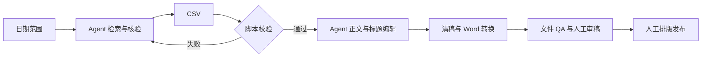

# Industrial AI Weekly Pipeline

**从三个独立 Skill，到一条可重复运行的工业 AI 内容生产流程。**

这是一个来自实际周报工作的 Agent 工作流作品：将检索、信源整理、长文撰写、标题编辑和 Word 交付串联起来，并把多轮审稿反馈转化为可复用的质量标准。

`Workflow Design` · `Editorial Operations` · `Agent Skills` · `Python Validation`

## 作品概览

| 维度 | 内容 |
|---|---|
| 场景 | 工业 AI 行业研究与周期性内容生产 |
| 设计工作 | 流程整合、输入输出定义、编辑标准、质量检查和反馈迭代 |
| 交付 | 信源 CSV、正式 Markdown、Word、八个标题候选 |
| 复用证据 | 四个日期范围的实际落盘样本；后续样本为 25–30 条信源 |
| 技术组成 | 一个 Skill、两个 Python 辅助脚本、十项离线边界测试 |
| 人工环节 | 事实核验、编辑审稿、排版与发布决定 |

**版本说明：** 本仓库保留 2026-10-30 的工作流源码快照。完整出稿由 Agent 环境提供检索和写作能力；独立模型调用、定时运行和发布服务尚未接入。规则冲突与待完善项见 [已知问题](docs/known-issues.md)。

## 我的工作与协作分工

我把原先分开的搜集、写作、标题任务整合成连续流程，定义信源规模、日期范围和文件交付要求，并根据真实输出持续调整编辑标准。例如：让标题表达新的进展而非技术词拼接，将科研发表状态与阅读表达分开处理，以及防止内部采集备注进入正式稿。

AI 协助检索、起草、脚本实现和文件加工；我负责需求、反馈、验收与规则迭代；业务审稿、排版与发布保留人工协作。这个作品重点展示如何设计、检验和维护 AI 工作流。

## 解决什么问题

行业周报通常要在检索、资料表、写稿、标题和 Word 之间反复转交材料。这个项目将步骤、数据格式和编辑标准集中到一个 Skill，并将实际审稿反馈沉淀为后续运行要求。

核心产物：25–30 条信源 CSV、正式 Markdown、可编辑 DOCX、8 个标题候选。五类信源覆盖制造业巨头、工业 AI 技术产品、资本初创、科研与中小企业。

## 如何工作



Agent 按 Skill 执行语义任务；Python 处理结构校验和格式转换；人负责事实、表达、质量和发布决策。运行 Python 校验器不会自动搜新闻或写正式文章。

## 快速体验：不联网的校验示例

需要 Python 3.10 或以上版本。校验器与测试只使用标准库；以下命令在仓库根目录执行。

```sh
mkdir -p work
python3 skills/industrial-ai-weekly-pipeline/scripts/generate_report.py examples/synthetic_sources.csv --start 20261019 --end 20261025 --out work/scaffold.md
python3 -m unittest discover -s tests -v
```

示例包含 25 条明确标记的虚构数据，全部使用 `example.invalid`，仅演示格式与边界检查。它不是新闻样刊，也不能发布。输出 `scaffold.md` 是带占位文字的内部骨架。

## 使用完整 Skill

将 `skills/industrial-ai-weekly-pipeline/` 文件夹作为完整 Skill 交给支持此结构的 Agent 环境，按该环境的安装说明启用。环境还需要可用的联网搜索/页面阅读能力、文件系统和文档工具。

调用示例：

> 使用 industrial-ai-weekly-pipeline，生成指定起止日期范围的工业 AI 周报。核验原始来源与日期，五类各至少五条，共 25–30 条；输出信源 CSV、正式 Markdown、DOCX 与八个不同新闻点的标题。执行前阅读 docs/known-issues.md，并对冲突规则采用明确的本次任务要求。

Word 转换仅用于已经完成编辑的正式稿：

```sh
python3 -m venv .venv
.venv/bin/python -m pip install -r requirements.txt
.venv/bin/python skills/industrial-ai-weekly-pipeline/scripts/markdown_to_docx.py work/final.md --out work/final.docx
```

Windows 可使用虚拟环境中的 `Scripts/python.exe`。依赖文件只声明最低版本，尚未形成跨平台锁定环境。DOCX 生成后仍需字体、分页、PDF 以及原生保存重开检查。此包未包含完整的自动渲染工具链，也未完成 Word/WPS 双平台验收。

## 已核实的效果

本地文件审计覆盖四个日期范围，另保留同一期首版作为对照：初版为 15 条信源、无 Word；后续四个样本为 30、25、26、26 条，均有 Word，CSV 通过当前结构/数量/分类/日期检查。这里的“通过”不代表重新核验了每条网页事实。

不能由这些记录推出提效百分比、新闻准确率、全部公开发布、无人值守运行或多人使用。详见 [效果口径](docs/results.md)。

## 项目内容

| 路径 | 内容 |
|---|---|
| `skills/industrial-ai-weekly-pipeline/` | 当前 Skill、界面描述、CSV 骨架生成器、DOCX 转换器 |
| `docs/architecture.md` | 各阶段输入、动作、产物与人工边界 |
| `docs/evolution.md` | 从独立 Skill 到规则化流程的演进 |
| `docs/results.md` | 实际样本统计和证据范围 |
| `docs/known-issues.md` | 尚未修复的规则与代码问题 |
| `docs/release-plan.md` | 公开与后续自动化的具体路径 |
| `docs/verification.md` | 本次实际检查结果 |
| `examples/` | 虚构信源示例，不能作为新闻使用 |
| `tests/` | CSV 验证器的离线边界回归 |

## 分享边界

本仓库未包含原始聊天、内部链接、真实业务稿件、凭据、个人姓名和本地绝对路径。Skill 内的历史标题示例仅展示写法，不能视为已重新核实的新闻事实。

当前未指定开源许可证。作品展示与开源授权分别处理；如需复用或再分发，请先联系项目维护者确认授权范围。

参考：[OpenAI Skills](https://developers.openai.com/plugins/concepts/skills) · [GitHub 创建仓库](https://docs.github.com/en/repositories/creating-and-managing-repositories/creating-a-new-repository)
