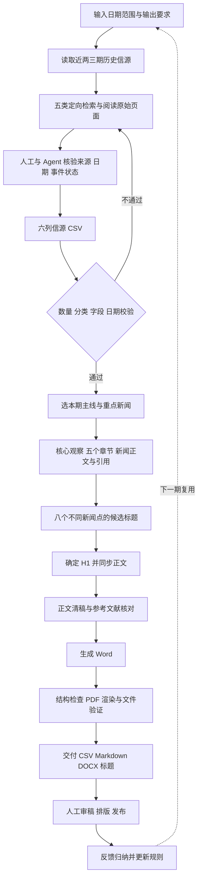

# Pipeline 与职责边界




标题筛选与写作在实际编辑中会往返。Skill 当前既写了“写作前生成候选选择 H1”，又写了“正文完成后生成标题”；应理解为先选主线、成稿后复核，未来宜将顺序统一，避免重复生成和文件不同步。

| 阶段 | 谁做什么 | 产物与验收 |
|---|---|---|
| 任务界定 | 人给定日期与用途；Agent 明确包含起止日和日期口径 | 日期范围；“上周”要转换为明确日期 |
| 历史去重 | Agent 读取最近 2–3 期；不可访问时记录限制 | 历史主角和重复事件清单；当前无专门去重程序 |
| 信源搜集 | Agent 使用联网工具检索与读原文 | 五类覆盖：巨头、技术产品、资本初创、科研、中小企业 |
| 证据核验 | Agent 与编辑核对发布时间、实际事件、金额、状态和学术载体 | 合格候选及内部核验记录；不能仅靠搜索摘要 |
| 结构校验 | `generate_report.py` 检查 CSV | 六列齐全、25–30 条、每类至少五条、两个日期在范围内 |
| 正文写作 | Agent 根据 Skill 写作；编辑决定事实与判断是否合理 | 核心观察、五章、逐条进展、对应引用 |
| 标题编辑 | Agent 提供选择，编辑确定主标题 | 八个尽量不同的新闻点；标题动作不超过来源支持程度 |
| 文档转换 | `markdown_to_docx.py` 转换正式稿 | 可编辑 DOCX；转换本身不等于发布级验收 |
| QA | 脚本检查确定性问题；渲染检查页面；人工审事实与传播表达 | CSV、MD、DOCX 内容一致；检查内部备注、引用、字体 |
| 发布 | 人工确认与其他人员排版/渠道发布 | 现有包未实现自动发布 |
| 规则维护 | 人提出反馈，Agent 抽取成可复用要求 | 下期可继承的编辑标准与回归用例 |

六列表头为：

```csv
title,published_at,event_date,content,link,category
```

`generate_report.py` 只验证填入的数据，生成分组骨架。它不会联网核实新闻，不会判断发布日期是否捏造，也不会完成正式写作。`markdown_to_docx.py` 不负责搜集或生成新闻。完整能力来自 **Agent + 联网工具 + Skill 指令 + 辅助脚本 + 人工审核**。
